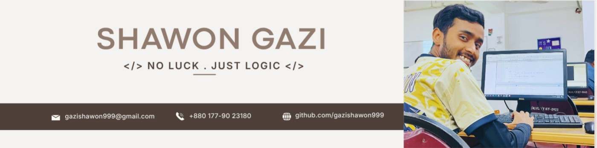
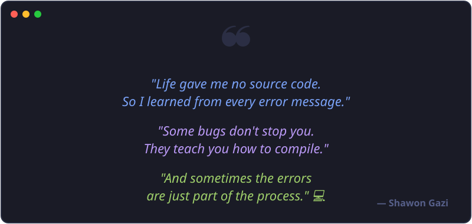

<h1 align="center">Hi 👋, I'm SHAWON GAZI</h1>
<h3 align="center">Full Stack Web Developer (Learning)</h3>

<!--- typo --->

  

- 👋 Hi, I’m **[@gazishawon999](https://github.com/gazishawon999)**
- 📝 I regularly write articles on **[LinkedIn](https://linkedin.com/in/gazishawon999)**
- 💬 Ask me about **C, Java, Algorithm, JavaScript, TypeScript, React.js, Next.js, Database (MySQL, MongoDB)**
- 📩 Email Me **gazishawon999@gmail.com**
- 🌐 Explore My [Resume](https://drive.google.com/file/d/118NdPHholDLXVwkTJ1uunpJEw1Q7ajU6/view?usp=sharing)
- ⚡ Fun fact: **I think I am Curious.**

 

<h3 align="center">Connect with me:</h3>

  &nbsp;&nbsp;&nbsp;&nbsp;&nbsp;&nbsp;&nbsp;&nbsp;
  &nbsp;&nbsp;&nbsp;&nbsp;&nbsp;&nbsp;&nbsp;&nbsp;
  &nbsp;&nbsp;&nbsp;&nbsp;&nbsp;&nbsp;&nbsp;&nbsp;
  &nbsp;&nbsp;&nbsp;&nbsp;&nbsp;&nbsp;&nbsp;&nbsp;
  &nbsp;&nbsp;&nbsp;&nbsp;&nbsp;&nbsp;&nbsp;&nbsp;
  

 

<!--- technology --->
<h2 align="center"> TECHNOLOGY STACK:</h2>

 

<h3 align="center">Languages:</h3>

  &nbsp;&nbsp;&nbsp;&nbsp;
  &nbsp;&nbsp;&nbsp;&nbsp;
  &nbsp;&nbsp;&nbsp;&nbsp;
  &nbsp;&nbsp;&nbsp;&nbsp;
  &nbsp;&nbsp;&nbsp;&nbsp;
  &nbsp;&nbsp;&nbsp;&nbsp;
  

<h3 align="center">CSS Frameworks & Libraries:</h3>

  &nbsp;&nbsp;&nbsp;&nbsp;
  

<h3 align="center">JavaScript Frameworks & Libraries:</h3>

  &nbsp;&nbsp;&nbsp;&nbsp;
  &nbsp;&nbsp;&nbsp;&nbsp;
  &nbsp;&nbsp;&nbsp;&nbsp;
  &nbsp;&nbsp;&nbsp;&nbsp;
  

<h3 align="center">Database & Model:</h3>

  &nbsp;&nbsp;&nbsp;&nbsp;
  

<h3 align="center">Deployment Platform:</h3>

  &nbsp;&nbsp;&nbsp;&nbsp;
  &nbsp;&nbsp;&nbsp;&nbsp;
  

<h3 align="center">Design & Graphics:</h3>

  

<h3 align="center">Tools & Technologies:</h3>

  &nbsp;&nbsp;&nbsp;&nbsp;
  &nbsp;&nbsp;&nbsp;&nbsp;
  &nbsp;&nbsp;&nbsp;&nbsp;
  &nbsp;&nbsp;&nbsp;&nbsp;
  &nbsp;&nbsp;&nbsp;&nbsp;
  &nbsp;&nbsp;&nbsp;&nbsp;
  &nbsp;&nbsp;&nbsp;&nbsp;
  

 

<!-- Statistics -->

## 📊 GITHUB STATISTICS & ANALYSIS

### 🐍 GitHub Contributions

  <picture>
    <source media="(prefers-color-scheme: dark)" srcset="https://raw.githubusercontent.com/gazishawon999/gazishawon999/output/github-contribution-grid-snake-dark.svg">
    <source media="(prefers-color-scheme: light)" srcset="https://raw.githubusercontent.com/gazishawon999/gazishawon999/output/github-contribution-grid-snake.svg">
    
  </picture>

### 📈 GitHub Statistics

  
  

### 🔥 GitHub Streak

  

<!-- This for my banner "Quotes SVG image showing codes, for future work here stored.." -->
<!--
 
 

<!- Custom Tokyonight Quote SVG ->

  

&nbsp; <b><i>Let's connect and build something amazing!</i></b> &nbsp;

 

<!- Fancy Waving Footer ->

-->

<!-- Dev Quotes -->
 
 

  
  
    
  
  

    <i>"In a world full of GUIs, be a CLI."</i> 🖤  
    Always learning &nbsp;·&nbsp; Always shipping &nbsp;·&nbsp; Always automating
  

  
   
  
  
  &nbsp; <b><i>Let's connect and build something amazing!</i></b> &nbsp;
  

 

