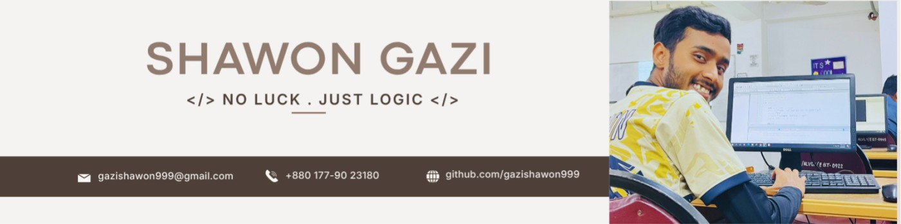

  <picture>
    <source media="(prefers-color-scheme: dark)" srcset="./scanner-dark.svg">
    <source media="(prefers-color-scheme: light)" srcset="./scanner-light.svg">
    
  </picture>

<h1 align="center">Hi 👋, I'm SHAWON GAZI</h1>

<h3 align="center">Full Stack Web Developer (Learning)</h3>

  

<!--- typo section --->

  

- 👋 Hi, I’m **[@gazishawon999](https://github.com/gazishawon999)**
- 📝 I regularly write articles on **[LinkedIn](https://linkedin.com/in/gazishawon999)**
- 💬 Ask me about **C, Java, Algorithm, JavaScript, TypeScript, React.js, Next.js, Database (MySQL, MongoDB)**
- 📩 Email Me **gazishawon999@gmail.com**
- 🌐 Explore My [Resume](https://drive.google.com/file/d/118NdPHholDLXVwkTJ1uunpJEw1Q7ajU6/view?usp=sharing)
- ⚡ Fun fact: **I think I am Curious.**

 
<!-- Custom Divider -->

<!-- My Social Media Accounts Section Below -->

<h3 align="center">Connect with me:</h3>

  &nbsp;&nbsp;&nbsp;&nbsp;&nbsp;&nbsp;&nbsp;&nbsp;
  &nbsp;&nbsp;&nbsp;&nbsp;&nbsp;&nbsp;&nbsp;&nbsp;
  &nbsp;&nbsp;&nbsp;&nbsp;&nbsp;&nbsp;&nbsp;&nbsp;
  &nbsp;&nbsp;&nbsp;&nbsp;&nbsp;&nbsp;&nbsp;&nbsp;
  &nbsp;&nbsp;&nbsp;&nbsp;&nbsp;&nbsp;&nbsp;&nbsp;
  

<!-- Portfolio Preview Section -->
<h3 align="center">🌐 Check Out My Portfolio</h3>

  

  

<!-- Custom Divider -->

<!--- technology section--->
<h2 align="center"> TECHNOLOGY STACK:</h2>

 

<h3 align="center">Languages:</h3>

  &nbsp;&nbsp;&nbsp;&nbsp;
  &nbsp;&nbsp;&nbsp;&nbsp;
  &nbsp;&nbsp;&nbsp;&nbsp;
  &nbsp;&nbsp;&nbsp;&nbsp;
  &nbsp;&nbsp;&nbsp;&nbsp;
  &nbsp;&nbsp;&nbsp;&nbsp;
  &nbsp;&nbsp;&nbsp;&nbsp;
  

<h3 align="center">CSS Frameworks & Libraries:</h3>

  &nbsp;&nbsp;&nbsp;&nbsp;
  

<h3 align="center">JavaScript Frameworks & Libraries:</h3>

  &nbsp;&nbsp;&nbsp;&nbsp;
  &nbsp;&nbsp;&nbsp;&nbsp;
  &nbsp;&nbsp;&nbsp;&nbsp;
  &nbsp;&nbsp;&nbsp;&nbsp;
  
  

<h3 align="center">Database & Models:</h3>

  &nbsp;&nbsp;&nbsp;&nbsp;
  

<h3 align="center">Deployment Platform:</h3>

  &nbsp;&nbsp;&nbsp;&nbsp;
  &nbsp;&nbsp;&nbsp;&nbsp;
  &nbsp;&nbsp;&nbsp;&nbsp;
  

<h3 align="center">Design & Graphics:</h3>

  &nbsp;&nbsp;&nbsp;&nbsp;
  

<h3 align="center">Tools & Technologies:</h3>

  &nbsp;&nbsp;&nbsp;&nbsp;
  &nbsp;&nbsp;&nbsp;&nbsp;
  &nbsp;&nbsp;&nbsp;&nbsp;
  &nbsp;&nbsp;&nbsp;&nbsp;
  &nbsp;&nbsp;&nbsp;&nbsp;
  &nbsp;&nbsp;&nbsp;&nbsp;
  &nbsp;&nbsp;&nbsp;&nbsp;
  

<!-- Custom Divider -->

 

<!-- Statistics -->

## 📊 GITHUB STATISTICS & ANALYSIS

### 🐍 GitHub Contributions

  <picture>
    <source media="(prefers-color-scheme: dark)" srcset="https://raw.githubusercontent.com/gazishawon999/gazishawon999/output/github-contribution-grid-snake-dark.svg?v=1">
    <source media="(prefers-color-scheme: light)" srcset="https://raw.githubusercontent.com/gazishawon999/gazishawon999/output/github-contribution-grid-snake.svg?v=1">
    
  </picture>

### 📈 GitHub Statistics & Languages

  <picture>
    <source media="(prefers-color-scheme: dark)" srcset="https://github-readme-stats.vercel.app/api?username=gazishawon999&theme=tokyonight&hide_border=true&include_all_commits=false&count_private=false&v=2">
    <source media="(prefers-color-scheme: light)" srcset="https://github-readme-stats.vercel.app/api?username=gazishawon999&theme=swift&hide_border=true&include_all_commits=false&count_private=false&v=2">
    
  </picture>
  &nbsp;&nbsp;
  <!-- Premium Language Card -->
  <picture>
    <source media="(prefers-color-scheme: dark)" srcset="https://github-profile-summary-cards.vercel.app/api/cards/most-commit-language?username=gazishawon999&theme=tokyonight&hide_title=false&hide_border=true&v=2">
    <source media="(prefers-color-scheme: light)" srcset="https://github-profile-summary-cards.vercel.app/api/cards/most-commit-language?username=gazishawon999&theme=default&hide_title=false&hide_border=true&v=2">
    
  </picture>

### ⏱️ Productivity & Streak

  <!-- Premium Productive Time Card -->
  <picture>
    <source media="(prefers-color-scheme: dark)" srcset="https://github-profile-summary-cards.vercel.app/api/cards/productive-time?username=gazishawon999&theme=tokyonight&utcOffset=6&hide_border=true&v=2">
    <source media="(prefers-color-scheme: light)" srcset="https://github-profile-summary-cards.vercel.app/api/cards/productive-time?username=gazishawon999&theme=default&utcOffset=6&hide_border=true&v=2">
    
  </picture>
  &nbsp;&nbsp;
  <!-- Fixed Streak Card with v=2 -->
  <picture>
    <source media="(prefers-color-scheme: dark)" srcset="https://github-readme-streak-stats.herokuapp.com/?user=gazishawon999&theme=tokyonight&hide_border=true&v=2">
    <source media="(prefers-color-scheme: light)" srcset="https://github-readme-streak-stats.herokuapp.com/?user=gazishawon999&theme=default&hide_border=true&v=2">
    
  </picture>

<!-- Top Languages -->
<h3 align="center">📊 Activity Graph</h3>

  <picture>
    <source media="(prefers-color-scheme: dark)" srcset="https://github-profile-summary-cards.vercel.app/api/cards/profile-details?username=gazishawon999&theme=tokyonight&v=2">
    <source media="(prefers-color-scheme: light)" srcset="https://github-profile-summary-cards.vercel.app/api/cards/profile-details?username=gazishawon999&theme=default&v=2">
    
  </picture>

<!-- Dev Quotes -->
 
 

  <picture>
    <source media="(prefers-color-scheme: dark)" srcset="https://quotes-github-readme.vercel.app/api?type=horizontal&theme=tokyonight&v=2">
    <source media="(prefers-color-scheme: light)" srcset="https://quotes-github-readme.vercel.app/api?type=horizontal&theme=default&v=2">
    
  </picture>
  <!-- Custom Divider -->

    
  
  

    <i>"In a world full of GUIs, be a CLI."</i> 🖤  
    Always learning &nbsp;·&nbsp; Always shipping &nbsp;·&nbsp; Always automating
  

  
   
  
  
  &nbsp; <b><i>Let's connect and build something amazing!</i></b> &nbsp;
  

 

